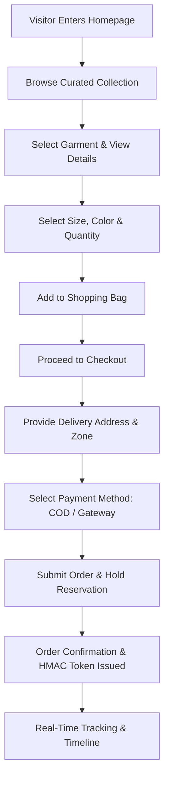
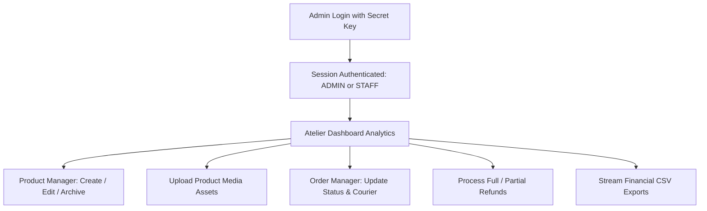
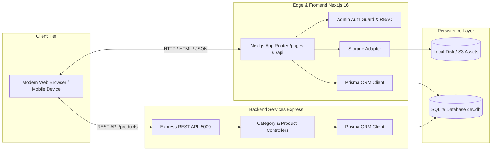

# Document 1: Project Overview & Executive Summary

## 1. Executive Summary & Brand Identity

**NOIR & GOLD** is an haute couture digital atelier and luxury e-commerce platform designed for discerning clientele seeking artisanal Pakistani garments, bespoke silhouettes, and premium fabrics. Combining minimalist, editorial aesthetics (deep obsidian `#0D0D0D`, rich champagne gold `#C9A84C`, warm parchment `#F9F6F0`) with modern full-stack web engineering, the platform delivers an immersive shopping experience and a comprehensive administrative command center.

The application is structured as a TypeScript monorepo powered by:
- **Frontend Presentation & APIs:** Next.js 16 (App Router), React 19, Tailwind CSS v4, and Prisma ORM client.
- **Dedicated Backend Service:** Express 4 REST API, Prisma ORM, CORS, and Morgan logging.
- **Relational Data Persistence:** SQLite database (`backend/prisma/dev.db`) encompassing 14 synchronized tables with atomic transactions and soft-delete capabilities.
- **Payment & Financial Architecture:** Support for Cash on Delivery (COD), local Pakistani electronic gateways (JazzCash, EasyPaisa, direct bank transfer), HMAC-SHA256 authenticated webhooks, capacity-checked refund issuance, and RFC-4180 streaming financial CSV exports.

---

## 2. Core Problem Solved & Business Context

Traditional luxury fashion platforms often struggle with three fundamental challenges:
1. **Inventory Concurrency & Overselling:** High-demand drop models risk overcommitting scarce stock when multiple customers attempt simultaneous checkouts. NOIR & GOLD resolves this through atomic inventory holds, optimistic locking, and state-machine-driven reservations.
2. **Administrative Friction:** Artisanal luxury collections require dynamic variant creation (sizes, bespoke colorways, custom SKUs), rich high-resolution photography pipelines, and fine-grained order status tracking. The atelier provides custom-built admin tooling with live variant matrices, drag-and-drop multipart upload pipelines, and real-time financial auditing.
3. **Regional Checkout Adaptability:** Serving both domestic Pakistani and international markets demands flexible payment handling, multi-zone shipping rate calculation (Sindh, Punjab, Islamabad/KPK/Balochistan), and strict fraud/rate-limiting defenses.

---

## 3. Live Functional Inventory & Feature Completion Matrix

| Domain | Feature | Engineering Implementation | Operational Status |
| :--- | :--- | :--- | :--- |
| **Catalog** | Public Garment Listing | Server/Client components, category filtering, search, pagination | ✅ Live & Operational |
| **Catalog** | Garment Detail View | Dynamic gallery, interactive size/color picker, stock checks | ✅ Live & Operational |
| **Cart** | Cart Management | Client-side reactive persistence, stock threshold validation | ✅ Live & Operational |
| **Checkout** | Multi-Zone Delivery | Dynamic calculation based on regional shipping zones & free delivery thresholds | ✅ Live & Operational |
| **Checkout** | Payment Selection | COD, JazzCash, EasyPaisa, Bank Transfer with verification tokens | ✅ Live & Operational |
| **Orders** | Public Order Tracking | Tokenized HMAC guest access (`/orders/[id]`), state machine timeline | ✅ Live & Operational |
| **Admin** | Role-Based Access Control | Cookie sessions, HMAC origin/CSRF checks, `ADMIN` vs `STAFF` segregation | ✅ Live & Operational |
| **Admin** | Catalog CRUD | Create/Edit garments, soft-delete archive & restore | ✅ Live & Operational |
| **Admin** | Variant Matrix Builder | Dynamic SKU generation, color hex mapping, inventory allocation | ✅ Live & Operational |
| **Admin** | Image Upload Pipeline | Multipart form handler, 5 MB payload limit, local & S3 storage abstraction | ✅ Live & Operational |
| **Admin** | Financial Ledger & Orders | Filterable order management, customer delivery inspection, payment logs | ✅ Live & Operational |
| **Admin** | Refund Processing | Atomic capacity checks, cumulative balance enforcement, event audit trail | ✅ Live & Operational |
| **Admin** | CSV Data Export | Streaming RFC-4180 export with complex date/status filtering | ✅ Live & Operational |
| **Security** | Rate Limiting | Dual checkout rate limiter (phone and IP abuse prevention) | ✅ Live & Operational |
| **Security** | Webhook Verification | HMAC-SHA256 signature enforcement, 300-second timestamp freshness window | ✅ Live & Operational |

---

## 4. End-to-End User Journeys

### 4.1 Customer Journey: Discover to Delivery



1. **Discovery & Exploration:** The customer browses the haute couture collection filtered by category (Bridal, Formal, Pret, Menswear) or search term.
2. **Product Engagement:** On the product detail page, high-resolution imagery displays fabric textures. Variant selectors dynamically update available stock, price deltas, and SKU identification.
3. **Shopping Bag:** Items are staged in a persistent shopping bag. Items exceeding remaining physical stock trigger immediate feedback.
4. **Checkout & Zone Calculation:** Customer enters recipient details. Shipping charges are evaluated against destination zones (e.g., Sindh vs. KPK) and waived if cart total surpasses the free-shipping threshold (e.g., PKR 15,000).
5. **Order Finalization:** Upon submission, an atomic transaction decreases variant stock, creates an `Order` record with order items, records an `InventoryReservation`, and issues a cryptographically secure guest lookup token.
6. **Guest Tracking:** The customer is redirected to `/orders/[id]?token=...` displaying live delivery status, courier tracking (TCS, Leopards, DHL), and payment receipt.

---

### 4.2 Administrative Journey: Catalog, Fulfillment & Governance



1. **Secure Access:** Administrators authenticate using email, password, and the administrative passphrase (`ADMIN_SESSION_SECRET`). Sessions are signed and stored in HTTP-only, SameSite cookies.
2. **Catalog Management:** The administrator creates new silhouettes or updates existing garments. The `VariantMatrixBuilder` generates SKUs across colorways and dimensions. Soft-delete functionality permits archiving garments without breaking historical customer orders.
3. **Asset Ingestion:** Media is uploaded via drag-and-drop. Assets are validated for MIME type, renamed with collision-resistant UUIDs, and written to persistent storage (`/public/uploads` or S3).
4. **Fulfillment Execution:** In the Orders Manager, staff update order progressions (`PENDING` -> `PROCESSING` -> `SHIPPED` -> `DELIVERED`). Assigning a courier and tracking code automatically updates customer tracking views.
5. **Ledger & Refunds:** For cancellations or returns, admins trigger atomic refunds against captured payments. The system strictly prevents refunds exceeding the original captured sum and records every event in `SecurityAuditLog`.
6. **Data Intelligence:** Administrators export filtered transaction records as RFC-4180 CSV files directly to their local workstation for accounting and inventory audits.

---

## 5. System Architecture Overview



- **Monorepo Cohesion:** Next.js 16 App Router handles server-rendered storefront views, customer mutations, authenticated admin dashboards, and specialized edge-like API routes. Express 4 operates as a high-throughput REST service for catalog ingestion, microservice decoupling, and external integration points.
- **Shared Relational Foundation:** Both frontend and backend connect to the common SQLite database (`backend/prisma/dev.db`), utilizing generated Prisma client definitions for type-safe relational queries.

---

## 6. Prerequisites & Quickstart Overview

To run NOIR & GOLD locally, your workstation requires:
- **Node.js:** `v20.17.0+` (LTS recommended)
- **Package Manager:** `npm` (Workspaces enabled)
- **Operating System:** Windows, macOS, or Linux
- **Environment Configuration:** Configured `.env` files in both `frontend/` and `backend/`.

### Quickstart Execution:
```bash
# 1. Clone repository & install dependencies
git clone <repository_url>
npm install

# 2. Synchronize database schema and seed data
npm run backend:db:push
npm run backend:db:seed

# 3. Launch full stack (Concurrent development servers)
# Terminal 1: Launch Backend API (Port 5000)
npm run backend:dev

# Terminal 2: Launch Frontend Atelier (Port 3000)
npm run frontend:dev
```

---

## 7. Known Limitations & Planned Enhancements

| Feature Area | Current Implementation | Planned Enhancement |
| :--- | :--- | :--- |
| **Database** | SQLite single-file relational database (`dev.db`) | Migration to managed PostgreSQL (e.g., Supabase / Neon) for high concurrency |
| **Search** | Case-insensitive SQL `contains` queries | Full-text indexing via PostgreSQL tsvector or Algolia search index |
| **Media Storage** | Local filesystem with S3 credential fallback | Multi-region CDN distribution via Cloudflare Images or AWS CloudFront |
| **Authentication** | Encrypted session cookie with secret passphrase | NextAuth / Auth.js with OAuth 2.0 (Google, Apple) and WebAuthn biometrics |
| **Internationalization** | PKR pricing and English language interface | Multi-currency (USD, EUR, AED, GBP) with real-time exchange rates and Urdu localization |
