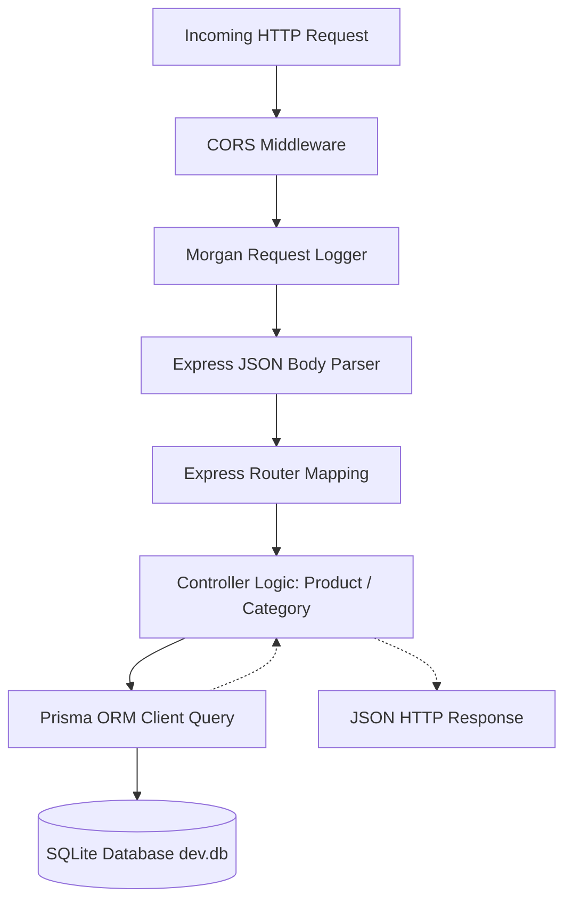

# Document 5: Backend Architecture & Express REST API

## 1. Express Service Overview

The backend microservice (`backend/`) is built on **Express 4.21.2** with TypeScript, executing on port 5000. It is engineered as a high-throughput, decoupled REST API capable of serving garment and category catalogs to diverse client surfaces without running through the Next.js server-rendering cycle.



---

## 2. Middleware Chain & Execution Lifecycle

Requests entering the Express application traverse four standardized middleware layers configured in `backend/src/app.ts`:

1. **CORS (Cross-Origin Resource Sharing):**
   ```typescript
   app.use(cors({
     origin: process.env.CLIENT_URL || "http://localhost:3000",
     credentials: true,
   }));
   ```
   Enables the frontend Next.js application to safely dispatch client-side API requests to port 5000 while rejecting unauthorized third-party origins.

2. **Morgan HTTP Logger:**
   ```typescript
   app.use(morgan("dev"));
   ```
   Outputs concise colored request logs (HTTP method, path, status code, response time in ms) to the terminal, essential for monitoring API throughput and diagnosing latency bottlenecks.

3. **Express JSON Body Parser:**
   ```typescript
   app.use(express.json());
   ```
   Parses incoming JSON payloads with a standardized 10 MB payload limit to prevent denial-of-service through memory exhaustion.

4. **Global Error-Handling Middleware:**
   Intersects unhandled controller exceptions, sanitizes error stack traces in production environments, and formats a consistent JSON error response:
   ```json
   {
     "success": false,
     "error": "Internal Server Error"
   }
   ```

---

## 3. Controller Pattern & Separation of Concerns

The Express backend strictly enforces a three-tier separation of concerns:
- **Routes Layer (`backend/src/routes/`):** Purely maps HTTP verbs and URL paths to corresponding controller methods. No business logic resides here.
- **Controller Layer (`backend/src/controllers/`):** Extracts parameters from `req.params`, `req.query`, and `req.body`, validates inputs, invokes Prisma operations, and formats HTTP responses.
- **Data Access Layer (`backend/prisma/`):** Manages relational queries, foreign key relations, and soft-delete criteria via the generated Prisma client.

### 3.1 Product Controller Implementation
```typescript
// backend/src/controllers/product.controller.ts
import { Request, Response } from "express";
import { PrismaClient } from "@prisma/client";

const prisma = new PrismaClient();

export const getProducts = async (req: Request, res: Response) => {
  try {
    const { category, search } = req.query;

    const products = await prisma.product.findMany({
      where: {
        deletedAt: null, // Soft-delete filter
        ...(category ? { category: { slug: String(category) } } : {}),
        ...(search ? {
          OR: [
            { title: { contains: String(search) } },
            { description: { contains: String(search) } },
          ],
        } : {}),
      },
      include: {
        variants: { where: { isActive: true } },
        images: { orderBy: { displayOrder: "asc" } },
        category: true,
      },
      orderBy: { createdAt: "desc" },
    });

    res.status(200).json({ success: true, count: products.length, data: products });
  } catch (error) {
    res.status(500).json({ success: false, error: "Failed to retrieve products" });
  }
};
```

### 3.2 Category Controller with Product Counters
```typescript
// backend/src/controllers/category.controller.ts
import { Request, Response } from "express";
import { PrismaClient } from "@prisma/client";

const prisma = new PrismaClient();

export const getCategories = async (_req: Request, res: Response) => {
  try {
    const categories = await prisma.category.findMany({
      where: { deletedAt: null },
      include: {
        _count: {
          select: { products: { where: { deletedAt: null } } },
        },
      },
      orderBy: { name: "asc" },
    });

    res.status(200).json({ success: true, data: categories });
  } catch (error) {
    res.status(500).json({ success: false, error: "Failed to retrieve categories" });
  }
};
```

---

## 4. Prisma Connection Management & Query Optimization

- **Singleton Pattern:** In long-running Express processes, a single `PrismaClient` instance is instantiated and reused across the entire application lifecycle. This maintains an internal connection pool with SQLite, avoiding connection churn.
- **Relational Eager Loading (`include`):** Instead of issuing multiple sequential queries (N+1 query problem), Prisma bundles queries for products, variants, images, and categories into optimized SQL transactions.
- **Soft-Delete Guardrails:** Both controllers filter by `deletedAt: null` across primary queries and nested relational counts, guaranteeing that archived garments do not appear in public catalog responses.

---

## 5. Architectural Comparison: Next.js API Routes vs. Express REST API

| Feature / Criterion | Next.js 16 Route Handlers | Express REST Backend |
| :--- | :--- | :--- |
| **Directory Location** | `frontend/src/app/api/v1/` | `backend/src/` |
| **Runtime Port** | `3000` (Collocated with Next.js) | `5000` (Dedicated Node process) |
| **Primary Responsibility** | Mutations, Auth, Admin Ops, Webhooks, CSV | Public Catalog Discovery & Category Feeds |
| **Authentication System** | Signed HTTP-Only Cookies (`admin-token`) | Stateless REST / Open Catalog |
| **Response Format** | `NextResponse.json(...)`, `ReadableStream` | Express `res.status().json(...)` |
| **Multipart Uploads** | Web standard `request.formData()` | Multer / Busboy integration (extensible) |
| **Streaming Capabilities** | Native Web Streams (`ReadableStream`) | Node.js stream piping (`res.write()`) |
