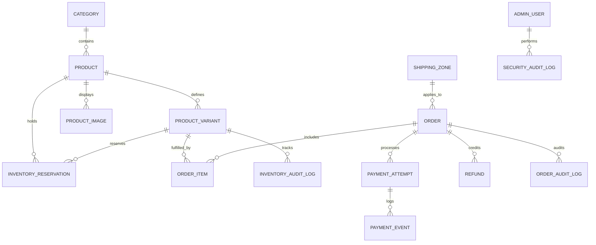

# Document 7: Database Design & Prisma ORM Deep-Dive

## 1. Relational Architecture & 14 Models

The NOIR & GOLD persistence layer is modeled in `backend/prisma/schema.prisma` and realized in SQLite (`backend/prisma/dev.db`). The architecture features 14 synchronized relational tables designed for financial precision, state machine tracking, and audit durability.



---

## 2. Model-by-Model Breakdown

### 2.1 Catalog & Product Models

#### `Category`
- `id` (String, PK, cuid/uuid)
- `name` (String, e.g., "Bridal", "Formal", "Pret")
- `slug` (String, Unique, URL identifier)
- `description` (String?)
- `deletedAt` (DateTime?, Soft delete index)
- `createdAt` / `updatedAt` (DateTime)

#### `Product`
- `id` (String, PK)
- `slug` (String, Unique)
- `title` (String)
- `description` (String)
- `fabric` (String, artisanal textile specification)
- `pricePkr` (Int, integer representation in PKR)
- `salePricePkr` (Int?)
- `isSoldOut` (Boolean, default false)
- `categoryId` (String, FK -> `Category.id`)
- `deletedAt` (DateTime?, indexed for soft-delete filtering)
- `createdAt` / `updatedAt` (DateTime)

#### `ProductVariant`
- `id` (String, PK)
- `productId` (String, FK -> `Product.id`, Cascade on delete)
- `size` (String, e.g., "XS", "S", "M", "L", "XL", "Custom")
- `colorName` (String, e.g., "Obsidian Noir", "Champagne Gold")
- `colorHex` (String, e.g., "#0D0D0D")
- `sku` (String, Unique, e.g., "NVS-BLK-M")
- `stock` (Int, physical inventory on hand)
- `pricePkr` (Int?)
- `isActive` (Boolean, default true)

#### `ProductImage`
- `id` (String, PK)
- `productId` (String, FK -> `Product.id`)
- `url` (String, local path or S3 URL)
- `alt` (String?)
- `isPrimary` (Boolean, default false)
- `displayOrder` (Int, default 0)

---

### 2.2 Order & Fulfillment Models

#### `Order`
- `id` (String, PK, e.g., "ord-2026-9812")
- `customerName` (String)
- `customerEmail` (String?)
- `customerPhone` (String, indexed for rate limiting and lookup)
- `shippingAddress` (String)
- `city` (String)
- `province` (String)
- `orderStatus` (String: `PENDING`, `CONFIRMED`, `PROCESSING`, `SHIPPED`, `DELIVERED`, `CANCELLED`)
- `paymentStatus` (String: `PENDING`, `PAID`, `FAILED`, `REFUNDED`, `PARTIALLY_REFUNDED`)
- `paymentMethod` (String: `COD`, `JAZZCASH`, `EASYPAISA`, `BANK_TRANSFER`)
- `subtotalPkr` (Int)
- `shippingFeePkr` (Int)
- `totalAmountPkr` (Int)
- `courierName` (String?, e.g., "TCS", "Leopards")
- `trackingNumber` (String?)
- `tokenHash` (String, SHA256 hash for guest HMAC tracking)
- `deletedAt` (DateTime?, soft-delete index)
- `createdAt` / `updatedAt` (DateTime)

#### `OrderItem`
- `id` (String, PK)
- `orderId` (String, FK -> `Order.id`)
- `variantId` (String, FK -> `ProductVariant.id`)
- `productTitle` (String, snapshot at purchase time)
- `variantSku` (String, snapshot)
- `size` (String)
- `colorName` (String)
- `unitPricePkr` (Int)
- `quantity` (Int)
- `totalPricePkr` (Int)

#### `ShippingZone`
- `id` (String, PK)
- `name` (String, e.g., "Sindh", "Punjab", "KPK / Balochistan")
- `baseRatePkr` (Int)
- `freeDeliveryThresholdPkr` (Int)
- `estimatedDays` (String)

---

### 2.3 Financial & State Ledger Models

#### `PaymentAttempt`
- `id` (String, PK)
- `orderId` (String, FK -> `Order.id`)
- `attemptKey` (String, Unique per order for idempotency)
- `provider` (String, "JAZZCASH", "EASYPAISA", "STRIPE")
- `amountPkr` (Int)
- `currency` (String, default "PKR")
- `status` (String: `INITIATED`, `PENDING_GATEWAY`, `CAPTURED`, `FAILED`, `CANCELLED`)
- `providerReference` (String?)
- `createdAt` / `updatedAt` (DateTime)

#### `PaymentEvent`
- `id` (String, PK)
- `paymentAttemptId` (String, FK -> `PaymentAttempt.id`)
- `providerEventId` (String, Unique)
- `eventType` (String, e.g., "payment.captured", "payment.failed")
- `payload` (String, raw JSON for immutable auditing)
- `processedAt` (DateTime, default `now()`)

#### `Refund`
- `id` (String, PK)
- `orderId` (String, FK -> `Order.id`)
- `gatewayRefundId` (String?)
- `amountPkr` (Int)
- `reason` (String)
- `refundMethod` (String: "GATEWAY", "BANK_TRANSFER", "STORE_CREDIT")
- `status` (String: `PENDING`, `COMPLETED`, `FAILED`)
- `processedBy` (String?, admin user id)
- `createdAt` / `updatedAt` (DateTime)

#### `InventoryReservation`
- `id` (String, PK)
- `productId` (String, FK -> `Product.id`)
- `productVariantId` (String, FK -> `ProductVariant.id`)
- `quantity` (Int)
- `reservationKey` (String, Unique checkout idempotency token)
- `expiresAt` (DateTime, time-bounded checkout lock)
- `isConsumed` (Boolean, default false)
- `isReleased` (Boolean, default false)

---

### 2.4 Auditing & Governance Models

#### `SecurityAuditLog`
- `id` (String, PK)
- `action` (String, e.g., "PRICE_CHANGE", "ADMIN_LOGIN", "REFUND_ISSUED", "PRODUCT_ARCHIVED")
- `targetResource` (String, e.g., "Product:prod-001", "Order:ord-9812")
- `performedBy` (String, admin email or "SYSTEM")
- `ipAddress` (String?)
- `metadata` (String?, JSON snapshot of prior and new states)
- `createdAt` (DateTime, default `now()`, immutable)

#### `OrderAuditLog` & `InventoryAuditLog`
- Immutable records capturing chronological transitions in order statuses and physical variant stock levels.

---

## 3. Soft-Delete Architecture

In enterprise e-commerce, **physical row deletion (`DELETE FROM table`) is strictly prohibited** for products and categories because historical customer orders rely on those records for receipts, invoices, and accounting audits.

### Implementation Standard:
1. Every major entity (`Product`, `Category`, `Order`) possesses a nullable `deletedAt DateTime?` column.
2. An index is declared on the column (`@@index([deletedAt])`) for zero-overhead query filtering.
3. When an entity is archived:
   ```typescript
   await prisma.product.update({
     where: { id: productId },
     data: { deletedAt: new Date(), isSoldOut: true },
   });
   ```
4. When queried across public and admin interfaces:
   ```typescript
   where: { deletedAt: null }
   ```
5. Soft-deleted entities can be instantly restored without data loss:
   ```typescript
   await prisma.product.update({
     where: { id: productId },
     data: { deletedAt: null, isSoldOut: false },
   });
   ```

---

## 4. 10 Essential Real-World Prisma Query Patterns

### Query 1: Eager-Loaded Catalog with Soft-Delete Filter
```typescript
const products = await prisma.product.findMany({
  where: { deletedAt: null, isSoldOut: false },
  include: {
    category: true,
    variants: { where: { isActive: true } },
    images: { orderBy: { displayOrder: "asc" } },
  },
});
```

### Query 2: Atomic Inventory Decrement with Optimistic Locking
```typescript
const updated = await prisma.productVariant.updateMany({
  where: { id: variantId, stock: { gte: quantityToBuy } },
  data: { stock: { decrement: quantityToBuy } },
});
if (updated.count === 0) throw new Error("INSUFFICIENT_STOCK");
```

### Query 3: Multi-Table Transaction (Order + Items + Reservation)
```typescript
const result = await prisma.$transaction(async (tx) => {
  const order = await tx.order.create({ data: orderData });
  await tx.orderItem.createMany({ data: itemsData });
  await tx.inventoryReservation.create({ data: reservationData });
  return order;
});
```

### Query 4: Aggregate Refund Capacity Verification
```typescript
const aggregate = await prisma.refund.aggregate({
  where: { orderId, status: "COMPLETED" },
  _sum: { amountPkr: true },
});
const totalRefunded = aggregate._sum.amountPkr || 0;
```

### Query 5: Security Audit Log Ingestion
```typescript
await prisma.securityAuditLog.create({
  data: {
    action: "ADMIN_LOGIN_SUCCESS",
    targetResource: "AdminSession",
    performedBy: adminEmail,
    ipAddress: clientIp,
    metadata: JSON.stringify({ role: "ADMIN", userAgent }),
  },
});
```

### Query 6: Check Active Idempotent Payment Attempt
```typescript
const attempt = await prisma.paymentAttempt.findUnique({
  where: { orderId_attemptKey: { orderId, attemptKey } },
});
```

### Query 7: Filter Orders for CSV Export with Date Range
```typescript
const orders = await prisma.order.findMany({
  where: {
    deletedAt: null,
    orderStatus: statusFilter !== "ALL" ? statusFilter : undefined,
    createdAt: { gte: startDate, lte: endDate },
  },
  include: { items: true, refunds: true },
  orderBy: { createdAt: "desc" },
});
```

### Query 8: Soft-Delete Product and Audit
```typescript
await prisma.$transaction([
  prisma.product.update({ where: { id }, data: { deletedAt: new Date() } }),
  prisma.securityAuditLog.create({ data: { action: "PRODUCT_ARCHIVE", targetResource: `Product:${id}`, performedBy: adminUser } }),
]);
```

### Query 9: Restore Soft-Deleted Product
```typescript
await prisma.product.update({
  where: { id },
  data: { deletedAt: null, isSoldOut: false },
});
```

### Query 10: Find and Release Expired Reservations
```typescript
const expired = await prisma.inventoryReservation.findMany({
  where: { expiresAt: { lt: new Date() }, isConsumed: false, isReleased: false },
});
```
