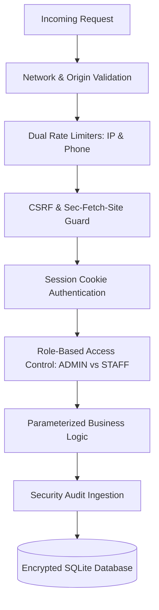

# Document 8: Authentication, Authorization & Security Architecture

## 1. Security Philosophy & Defense-in-Depth

The NOIR & GOLD platform handles high-value financial transactions, sensitive customer delivery data, and privileged catalog pricing. Security is structured on a multi-layered **Defense-in-Depth** model:



---

## 2. Administrative Authentication & Session Cookies

### 2.1 Credential Verification & Session Creation
Administrative access requires three credentials:
1. **Registered Admin Email**
2. **Password Hash**
3. **Master Secret Key (`ADMIN_SESSION_SECRET`)**

When authenticated via `/api/v1/admin/auth/login`:
- The server generates an HMAC-SHA256 signed session payload encoding: `email`, `role`, `issuedAt`, and `expiresAt`.
- The session token is transmitted to the client inside an HTTP-Only cookie:
  ```typescript
  response.cookies.set("admin-token", token, {
    httpOnly: true,
    secure: process.env.NODE_ENV === "production",
    sameSite: "lax",
    path: "/",
    maxAge: 60 * 60 * 8, // 8 hours duration
  });
  ```

### 2.2 Security Benefits of HTTP-Only Cookies
- **Zero XSS Token Exposure:** Client-side JavaScript running in the browser cannot read or copy the `admin-token` cookie via `document.cookie`.
- **Automatic Browser Attachment:** Subsequent requests from the admin dashboard automatically transmit the cookie across all origin requests.

---

## 3. Role-Based Access Control (RBAC): `ADMIN` vs. `STAFF`

The system defines two administrative tiers in `frontend/src/lib/admin-auth-guard.ts`:

| Permission / Operation | `ADMIN` Role | `STAFF` Role | Implementation Guard |
| :--- | :---: | :---: | :--- |
| **View Orders & Fulfillment** | ✅ Allowed | ✅ Allowed | `requireAdminOrStaff(req)` |
| **Update Courier & Tracking** | ✅ Allowed | ✅ Allowed | `requireAdminOrStaff(req)` |
| **View Garment Catalog** | ✅ Allowed | ✅ Allowed | `requireAdminOrStaff(req)` |
| **Edit Inventory Quantities** | ✅ Allowed | ✅ Allowed | `requireAdminOrStaff(req)` |
| **Upload Product Photography** | ✅ Allowed | ✅ Allowed | `requireAdminOrStaff(req)` |
| **Download Financial CSV** | ✅ Allowed | ✅ Allowed | `requireAdminOrStaff(req)` |
| **Create New Garments** | ✅ Allowed | ❌ Forbidden (403) | `requireAdminRole(req)` |
| **Modify Base Garment Prices** | ✅ Allowed | ❌ Forbidden (403) | `requireAdminRole(req)` |
| **Soft-Delete / Archive Garments**| ✅ Allowed | ❌ Forbidden (403) | `requireAdminRole(req)` |
| **Issue Financial Refunds** | ✅ Allowed | ❌ Forbidden (403) | `requireAdminRole(req)` |

---

## 4. Payment Gateway Webhook Security

Payment webhooks (`/api/v1/payments/webhook`) execute state changes (e.g., marking orders as `PAID`). Consequently, they must withstand tampering, replay attacks, and spoofing:

### 4.1 Elimination of Insecure Fallback & Fail-Closed Enforcement
```typescript
const secret = process.env.PAYMENT_WEBHOOK_SECRET;
if (!secret) {
  if (process.env.NODE_ENV === "production") {
    console.error("FATAL: PAYMENT_WEBHOOK_SECRET is not configured.");
    return NextResponse.json(
      { success: false, error: { code: "WEBHOOK_CONFIG_ERROR", message: "Webhook secret missing." } },
      { status: 500 }
    );
  }
}
```

### 4.2 HMAC-SHA256 Signature Verification
The webhook calculates the expected HMAC over the raw request payload:
```typescript
const hmac = crypto.createHmac("sha256", secret);
hmac.update(rawBody);
const expectedSignature = hmac.digest("hex");

// Timing-safe comparison prevents timing side-channel attacks
const isValid = crypto.timingSafeEqual(
  Buffer.from(providedSignature, "hex"),
  Buffer.from(expectedSignature, "hex")
);
```

### 4.3 300-Second Timestamp Freshness Window (Anti-Replay)
```typescript
const webhookTime = parseInt(req.headers.get("x-payment-timestamp") || "0", 10);
const currentTime = Math.floor(Date.now() / 1000);

if (Math.abs(currentTime - webhookTime) > 300) {
  return NextResponse.json(
    { success: false, error: { code: "REPLAY_DETECTED", message: "Timestamp expired." } },
    { status: 408 }
  );
}
```

---

## 5. Rate Limiting Architecture

To protect against credential stuffing and checkout denial-of-service, the platform enforces memory-bounded rate limiters:

### 5.1 Dual Checkout Limiter (Phone & IP)
Protects the public `/api/v1/orders` endpoint:
- **Phone Limiter:** Maximum 5 order placements per 15 minutes per customer phone number.
- **IP Limiter:** Maximum 10 order placements per 15 minutes per client IP address.
- **Behavior on Violation:** Returns HTTP `429 Too Many Requests` with a `Retry-After: 900` header.

### 5.2 Admin Login Brute-Force Limiter
Protects `/api/v1/admin/auth/login`:
- Maximum 5 failed login attempts per 15 minutes per target email address.
- Resets upon successful authentication.

---

## 6. CSRF Defense & Origin Validation

For state-changing mutations (`POST`, `PATCH`, `DELETE`):
1. **Origin Verification:** The `Origin` or `Referer` header must match the authorized host (`localhost:3000` or production domain).
2. **`Sec-Fetch-Site` Inspection:** Modern browsers send `Sec-Fetch-Site`. The guard rejects requests if `Sec-Fetch-Site: cross-site`, neutralizing Cross-Site Request Forgery (CSRF).

---

## 7. SQL Injection Prevention & Input Sanitization

- **Prisma Parameterized Queries:** All database queries utilize Prisma's strongly typed query engine, which automatically escapes and parameterizes all inputs. Malicious strings like `' OR '1'='1` are treated strictly as literal string values, rendering SQL injection impossible.
- **Payload Clamping:** Checkout quantity requests are clamped between `1` and `10` units per variant, preventing integer overflow or negative inventory attacks.
- **Multipart Upload Sanitization:** Uploaded filenames are stripped of path-traversal sequences (`../`) and replaced with cryptographically random UUIDs (`uuid.v4() + ext`).

---

## 8. Security Audit Logging (`SecurityAuditLog`)

Every administrative or high-impact operational event is immutably appended to `SecurityAuditLog`:
- Admin sign-in (successful and failed attempts)
- Product price changes (capturing old price and new price in metadata)
- Soft-delete archiving and restorations
- Refund issuance (amount, reason, remaining balance)
- Webhook signature failures
