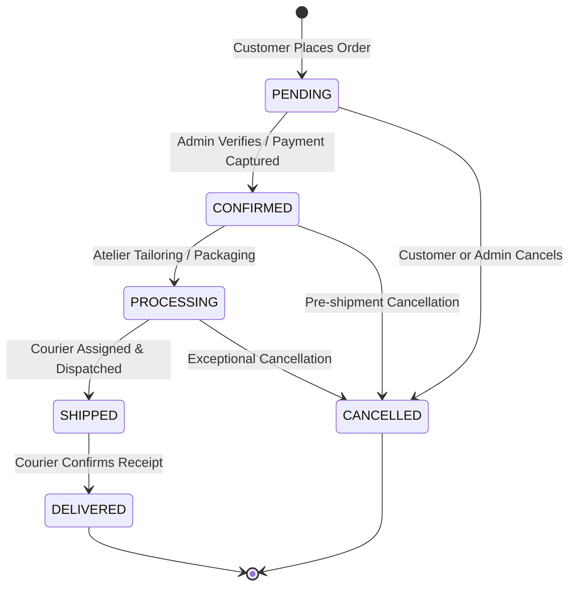
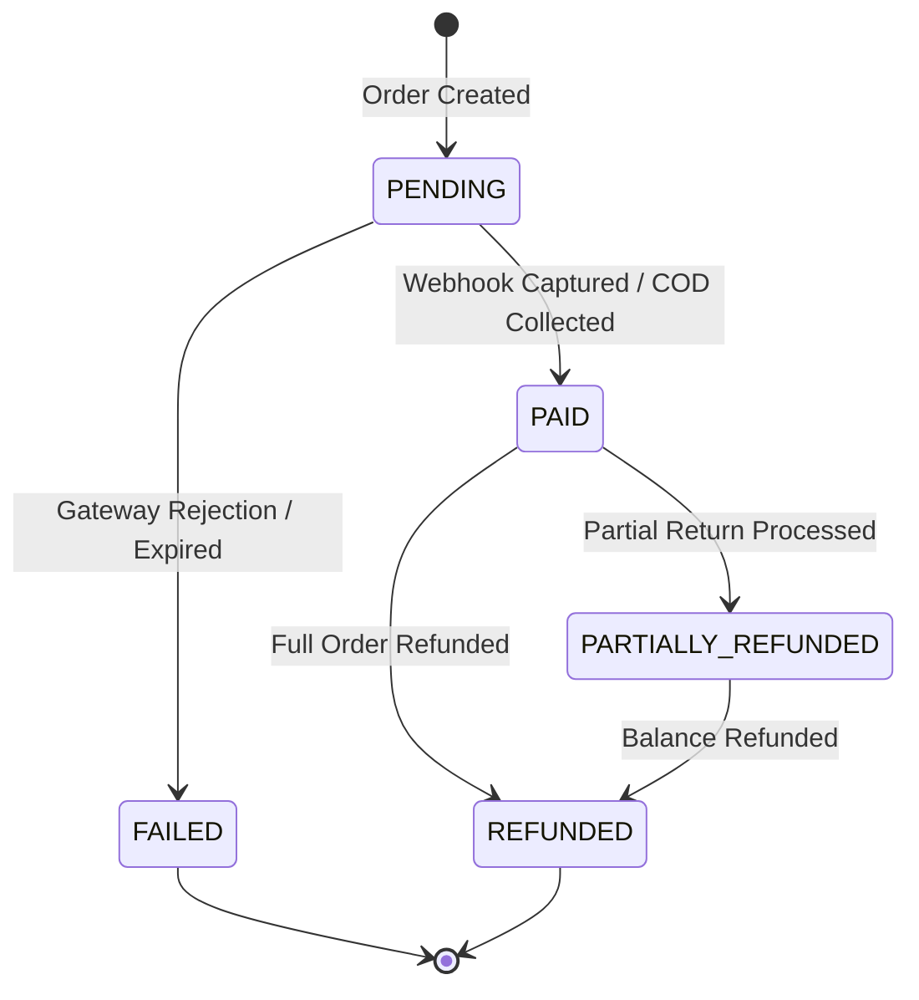
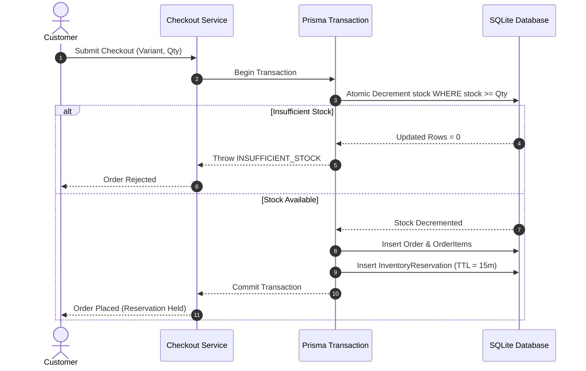
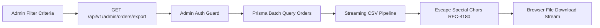

# Document 9: E-Commerce Business Workflows & State Machines

## 1. Order Lifecycle State Machine

Orders in NOIR & GOLD progress through a deterministic, strictly enforced finite state machine. Transitions that violate business logic (e.g., jumping from `PENDING` directly to `DELIVERED`) are rejected by `admin-order-update-service.ts`.

### Transition Rules & Restock Invariants:
1. **`PENDING` -> `CONFIRMED`:** Validates inventory reservation or captured payment.
2. **`CONFIRMED` -> `PROCESSING`:** Garment enters artisanal preparation.
3. **`PROCESSING` -> `SHIPPED`:** **Requires courier metadata** (`courierName` and `trackingNumber`). If missing, the transition fails.
4. **Transition to `CANCELLED`:**
   - **Atomic Restock:** Restores the exact physical inventory of each variant.
   - **Reservation Release:** Flags any active `InventoryReservation` as released to prevent duplicate restocks.
   - **Idempotency Guarantee:** Cancelling an already cancelled order is a no-op and will never double-restock inventory.

---

## 2. Payment Lifecycle State Machine

- **`PENDING`:** Default state for all newly created orders (both COD and gateway).
- **`PAID`:** Set when an HMAC webhook reports `payment.captured` or when an admin marks a COD order as collected upon delivery.
- **`PARTIALLY_REFUNDED`:** Set when an administrative refund is processed for an amount strictly less than `totalAmountPkr`.
- **`REFUNDED`:** Set when cumulative refunds match 100% of the captured sum.

---

## 3. Inventory Reservation & Stock Holding

To prevent overselling during flash atelier drops, the platform implements **Two-Phase Inventory Protection**:

### Reservation States:
- **Active Hold:** `isConsumed = false`, `isReleased = false`, `expiresAt > now()`. Stock is deducted from the physical counter.
- **Consumed:** When the order transitions to `CONFIRMED` or `SHIPPED`, the reservation is finalized.
- **Released (Restocked):** If an order is cancelled or times out, the reservation is released and variant stock is restored.

---

## 4. Complete Checkout Workflow

1. **Cart Review & Payload Submission:** The browser submits recipient details, variant IDs, and quantities to `/api/v1/orders`.
2. **Rate Limit Gate:** Dual checkout limiter verifies IP and phone request frequencies.
3. **Price & Shipping Recalculation:** The server does **not trust** prices submitted by the client. It queries the database for active prices and evaluates destination shipping zone thresholds:
   $$\text{Final Total} = \sum (\text{Variant Base Price} \times \text{Qty}) + \text{Zone Shipping Fee}$$
   If $\sum \text{Subtotal} \ge \text{Free Delivery Threshold}$, shipping is set to PKR 0.
4. **Atomic Transaction:** Creates `Order`, `OrderItem` records, decrements variant inventory, and generates an HMAC lookup token.
5. **Customer Redirect:** Returns HTTP 201 with the order tracking URL.

---

## 5. Refund Processing Workflow

1. **Admin Initiation:** An administrator submits a refund request for an order with a reason and amount in PKR.
2. **RBAC Verification:** `admin-auth-guard` ensures the user possesses the `ADMIN` role.
3. **Capacity Ledger Check:**
   $$\text{Max Refundable} = \text{Captured Amount} - \sum \text{Prior Completed Refunds}$$
   If $\text{Requested Amount} > \text{Max Refundable}$, the transaction is rejected with `CAPACITY_EXCEEDED`.
4. **Atomic Ledger Execution:**
   - Appends a new `Refund` row with status `COMPLETED`.
   - Updates `Order.paymentStatus` to `PARTIALLY_REFUNDED` or `REFUNDED`.
   - Appends an immutable record to `SecurityAuditLog`.

---

## 6. RFC-4180 Streaming CSV Export Workflow

- **RFC-4180 Compliance:** Fields containing commas, double quotes, or newlines are wrapped in quotation marks. Existing quotes are escaped as `""`.
- **Memory Efficiency:** Large order volumes are processed via Node streams, piping data directly to the HTTP response without loading millions of rows into server RAM.
- **Granular Filters:** Supports exporting by date ranges (`startDate`, `endDate`), payment status, and order status.
