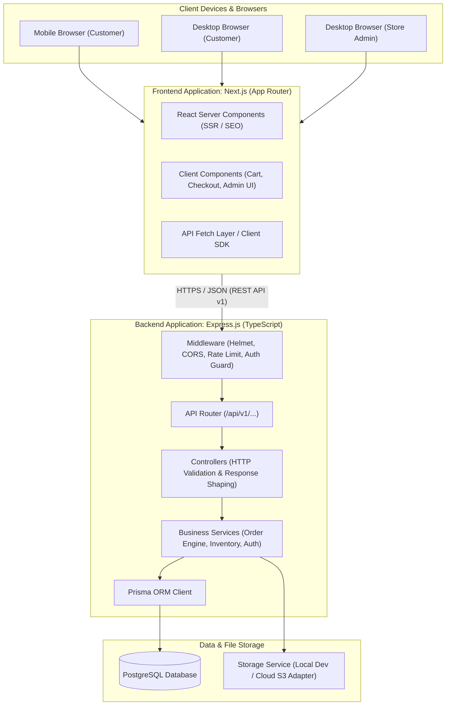
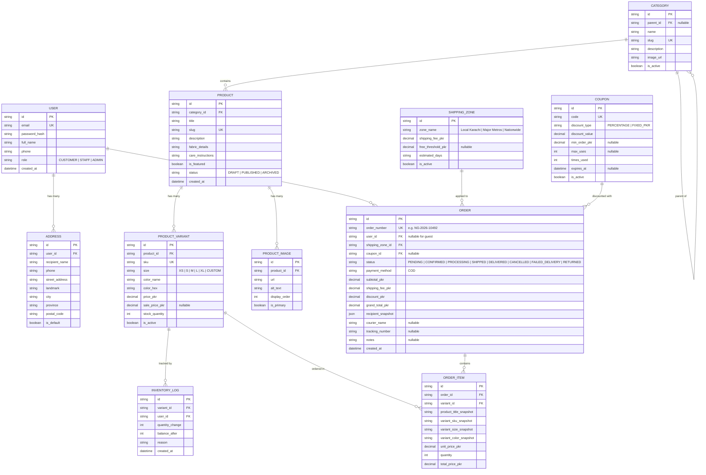

# System Architecture & Technical Design

**Project:** NOIR & GOLD — Luxury Apparel E-Commerce Store  
**Document Version:** 1.0.0  
**Status:** Approved for Implementation Planning  
**Date:** October 2026  

---

## 1. System Overview & Architecture Diagram

NOIR & GOLD employs a decoupled, multi-tier monorepo architecture. The frontend application is built with **Next.js (App Router)** and handles presentation, server-side page pre-rendering, search engine optimization (SEO), and client-side interactions. The backend is an autonomous **Express.js (TypeScript)** REST API providing business logic, catalog services, order processing, and authentication, backed by a **PostgreSQL** relational database accessed via **Prisma ORM**.



---

## 2. Technology Responsibilities & Layer Separation

### 2.1 Frontend: Next.js App Router & TypeScript
- **Server Components (RSC):**
  - Pre-render high-traffic product catalog pages, category listings, and marketing landing pages.
  - Dynamically inject OpenGraph tags, JSON-LD structured data (`schema.org/Product`), and title/description metadata for optimal search indexing.
  - Deliver zero-bundle-size server HTML for static luxury brand content.
- **Client Components (RCC):**
  - Isolate interactivity to user boundary components: Slide-over cart drawer, multi-angle gallery carousel, variant picker, live search bar, and dynamic checkout forms.
  - Manage client-side cached states (e.g., active cart items, notification toasts, modal states).
- **Presentation & Styling:**
  - Tailwind CSS with a customized design token palette (`obsidian`, `velvet`, `gold`, `pearl`).
  - Strict UI responsiveness across standard viewport sizes.

### 2.2 Backend: Express.js & TypeScript
- **Dedicated REST API:**
  - Complete operational independence from the presentation layer; communicates strictly through JSON over HTTPS under `/api/v1`.
  - Enforces all business rules, permissions, pricing, discounts, and inventory thresholds.
- **Middleware Pipeline:**
  - `helmet`: Enforces secure HTTP response headers (CSP, HSTS, X-Frame-Options).
  - `cors`: Strict origin validation, allowing requests only from configured frontend domains with credentials enabled.
  - `express-rate-limit`: Prevents brute-force credential stuffing on `/api/v1/auth` and denial-of-service abuse on search/checkout.
  - `cookie-parser`: Securely extracts and verifies signed authentication cookies.
  - `zod`: Request body, query param, and URL param runtime validation middleware.
  - Centralized error handler: Intercepts unhandled errors, logs detailed traces internally, and delivers sanitized, user-safe error payloads.

### 2.3 Database & ORM: PostgreSQL & Prisma
- **PostgreSQL:**
  - Robust relational integrity with explicit foreign key constraints, cascading rules, and unique constraints (SKUs, email addresses, order numbers).
  - Atomic transaction support (`ACID`) essential for concurrent checkout and stock reservation.
  - High-performance indexing on frequently queried columns (`slug`, `category_id`, `sku`, `order_status`, `created_at`).
- **Prisma ORM:**
  - Type-safe database client auto-generated from `schema.prisma`.
  - Declarative schema migrations ensuring synchronized database state across development, staging, and production.
  - High-level transactional support via `prisma.$transaction([ ... ])` to ensure all inventory decrements and order creation steps succeed or rollback together.

---

## 3. Monorepo Folder Structure

The repository is organized as a clean, unified monorepo housing the decoupled frontend and backend applications alongside shared types and project documentation:

```
cloths-store/
├── docs/                               # Architecture, design, and roadmap documents
│   ├── project-requirements.md
│   ├── architecture.md
│   ├── page-map.md
│   ├── design-system.md
│   ├── user-flows.md
│   └── implementation-roadmap.md
│
├── frontend/                           # Next.js App Router Application
│   ├── public/                         # Public static assets (favicons, brand badges)
│   ├── src/
│   │   ├── app/                        # Next.js App Router routes & layouts
│   │   │   ├── (storefront)/           # Public storefront route group
│   │   │   │   ├── layout.tsx          # Storefront shared header/footer layout
│   │   │   │   ├── page.tsx            # Homepage
│   │   │   │   ├── shop/
│   │   │   │   │   ├── page.tsx        # All products catalog
│   │   │   │   │   └── [category]/     # Category & subcategory views
│   │   │   │   ├── product/[slug]/     # Product details (SSR)
│   │   │   │   ├── cart/page.tsx       # Dedicated cart page
│   │   │   │   ├── checkout/           # Checkout & order confirmation
│   │   │   │   └── track-order/        # Public order status tracking
│   │   │   ├── (auth)/                 # Customer auth route group
│   │   │   │   ├── login/page.tsx
│   │   │   │   └── register/page.tsx
│   │   │   ├── (account)/              # Protected customer portal
│   │   │   │   ├── layout.tsx
│   │   │   │   ├── profile/page.tsx
│   │   │   │   ├── orders/page.tsx
│   │   │   │   └── addresses/page.tsx
│   │   │   ├── (admin)/                # Protected store management portal
│   │   │   │   ├── admin/layout.tsx    # Admin sidebar & header layout
│   │   │   │   ├── admin/dashboard/
│   │   │   │   ├── admin/products/
│   │   │   │   ├── admin/categories/
│   │   │   │   ├── admin/orders/
│   │   │   │   ├── admin/inventory/
│   │   │   │   ├── admin/coupons/
│   │   │   │   └── admin/shipping/
│   │   │   ├── api/                    # Next.js local API route handlers (if proxying)
│   │   │   └── layout.tsx              # Root HTML/Body layout with font imports
│   │   ├── components/                 # Reusable UI component library
│   │   │   ├── ui/                     # Design-system primitives (Button, Input, Modal, Badge)
│   │   │   ├── storefront/             # Storefront blocks (ProductCard, Gallery, CartDrawer)
│   │   │   └── admin/                  # Admin blocks (DataTable, VariantMatrixInput, OrderStatusBadge)
│   │   ├── hooks/                      # Custom React hooks (useCart, useDebounce, useAuth)
│   │   ├── lib/                        # Client utilities, API fetch client, formatters (PKR currency)
│   │   ├── styles/                     # Tailwind globals and luxury theme tokens
│   │   └── types/                      # Frontend-specific view model types
│   ├── tailwind.config.ts              # Tailwind configuration with NOIR & GOLD theme tokens
│   ├── tsconfig.json
│   ├── next.config.mjs
│   └── package.json
│
├── backend/                            # Express.js REST API Application
│   ├── prisma/                         # Database schema, migrations, and seed scripts
│   │   ├── schema.prisma
│   │   ├── migrations/
│   │   └── seed.ts                     # Initial seed for categories, admin, shipping zones
│   ├── src/
│   │   ├── config/                     # Environment variables, constants, DB client instance
│   │   ├── controllers/                # HTTP request handlers (auth, products, orders, etc.)
│   │   ├── services/                   # Core business logic (pricing, inventory, fulfillment)
│   │   ├── routes/                     # Versioned route declarations (/api/v1/...)
│   │   ├── middlewares/                # Auth guards, role checks, rate limiters, validation
│   │   ├── validators/                 # Zod validation schemas for all incoming payloads
│   │   ├── utils/                      # Password hashing, JWT helpers, order number generator
│   │   └── app.ts                      # Express app setup and server entry point
│   ├── uploads/                        # Local file uploads directory (development only)
│   ├── tsconfig.json
│   └── package.json
│
├── shared/                             # Shared contracts (types and DTO interfaces)
│   └── index.ts
│
└── package.json                        # Monorepo root package.json (workspaces configuration)
```

---

## 4. Authentication, Authorization & Security Strategy

### 4.1 Token Architecture & Session Storage
- **Access & Refresh Token Pair:**
  - **Access Token:** Short-lived JWT (15-minute expiration) containing essential claims (`userId`, `role`, `email`).
  - **Refresh Token:** Long-lived JWT (7-day expiration) stored securely in the database to allow revocation upon logout or security compromise.
- **Cookie Security:**
  - Both tokens are delivered to the browser inside `HttpOnly`, `SameSite=Strict`, `Secure` (in production) cookies.
  - `HttpOnly` prevents JavaScript access, neutralizing Cross-Site Scripting (XSS) token theft.
  - `SameSite=Strict` shields API endpoints from Cross-Site Request Forgery (CSRF).

### 4.2 Role-Based Access Control (RBAC)
- Express middleware inspects the verified JWT payload and enforces endpoint permissions:
  ```typescript
  // Middleware signature representation
  authenticateUser(req, res, next)
  requireRole(['ADMIN', 'STAFF'])(req, res, next)
  ```
- Admin endpoints reject non-administrative users with `403 Forbidden`.
- Customer routes restrict data access strictly to the authenticated `req.user.id`, preventing Insecure Direct Object Reference (IDOR) vulnerabilities (e.g., customers cannot inspect orders belonging to other customers).

### 4.3 Data Validation & Financial Integrity
- **Zod Runtime Validation:** Every incoming request body and query parameter is parsed against strict Zod schemas before reaching business logic controllers.
- **Server-Side Price Authority:**
  - The client provides only `{ variantId, quantity }`.
  - The backend recalculates item unit prices from database records, evaluates applicable coupon discount limits, verifies shipping zone rates based on the chosen city, and computes the exact grand total.
  - Under no circumstances does the backend accept or trust client-supplied price or discount amounts.
- **Transactional Stock Decrement:**
  - Order creation wraps variant stock verification, inventory decrement, order creation, and order items creation in a single `prisma.$transaction`.
  - If any variant has insufficient stock at the instant of order placement, the transaction rolls back cleanly with a descriptive error: `"Item '[Title] - [Size]' is out of stock."`

---

## 5. Conceptual Database Entity Models



---

## 6. Image Storage & Asset Management Strategy

### 6.1 Abstract Storage Adapter
To maintain complete decoupling and avoid vendor lock-in, image persistence is implemented through an abstract `StorageService` interface:

```typescript
export interface StorageService {
  uploadFile(file: Express.Multer.File, folder: string): Promise<{ url: string; fileKey: string }>;
  deleteFile(fileKey: string): Promise<boolean>;
}
```

- **Local Storage Provider (Development):** Files are saved to the `backend/uploads/` directory and served via a static Express route (`/uploads/*`). This permits local offline development with zero external cloud dependencies.
- **Cloud Storage Provider (Production):** Can plug into any S3-compatible service (AWS S3, Cloudflare R2, or Cloudinary) via environment variables (`STORAGE_DRIVER=s3`), uploading assets to a Content Delivery Network (CDN) bucket with optimized edge caching.

### 6.2 Asset Formatting & Responsive Loading
- High-resolution editorial images are normalized to standard aspect ratios (typically 3:4 portrait for clothing).
- Next.js Image component handles dynamic device resizing and outputs modern WebP/AVIF images with fallback support.

---

## 7. Architectural Decision Records (ADRs)

### ADR-01: Decoupled Monorepo (Next.js Frontend + Express.js Backend)
- **Context:** We evaluated building an all-in-one Next.js full-stack application versus a decoupled Next.js + Express.js setup.
- **Decision:** Separate the presentation layer (Next.js) from the core REST API (Express.js) in a single repository.
- **Rationale:** 
  1. Allows the backend REST API to serve potential future mobile applications (React Native / Flutter) or automated courier hooks without refactoring.
  2. Isolates backend business logic, database transactions, and cron jobs from serverless execution constraints.
  3. Preserves clean separation of concerns and clear responsibility boundaries.

### ADR-02: PostgreSQL with Prisma ORM
- **Context:** An e-commerce platform requires strict transactional guarantees for inventory tracking, monetary calculations, and relational catalog structures.
- **Decision:** Utilize PostgreSQL as the relational database engine and Prisma as the schema migration and query layer.
- **Rationale:** 
  1. PostgreSQL guarantees ACID compliance and handles complex relational constraints (products, variants, orders, items).
  2. Prisma provides end-to-end TypeScript type safety across database operations, eliminating common runtime data mismatch bugs.

### ADR-03: HttpOnly Cookie-Based JWT Session Management
- **Context:** Authenticating both customers and store administrators across web sessions.
- **Decision:** Use short-lived Access Tokens and long-lived Refresh Tokens delivered exclusively via `HttpOnly`, `SameSite=Strict`, `Secure` cookies.
- **Rationale:** Eliminates vulnerabilities associated with storing authentication tokens in browser `localStorage` or `sessionStorage` (which are susceptible to XSS).

### ADR-04: Server-Authoritative Checkout & Monetary Computation
- **Context:** Calculation of product costs, coupon reductions, and shipping fees.
- **Decision:** Enforce 100% server-side pricing recalculation upon checkout.
- **Rationale:** Client-submitted prices are inherently untrusted. Recalculating everything from database state guarantees financial integrity and prevents cart tampering.
