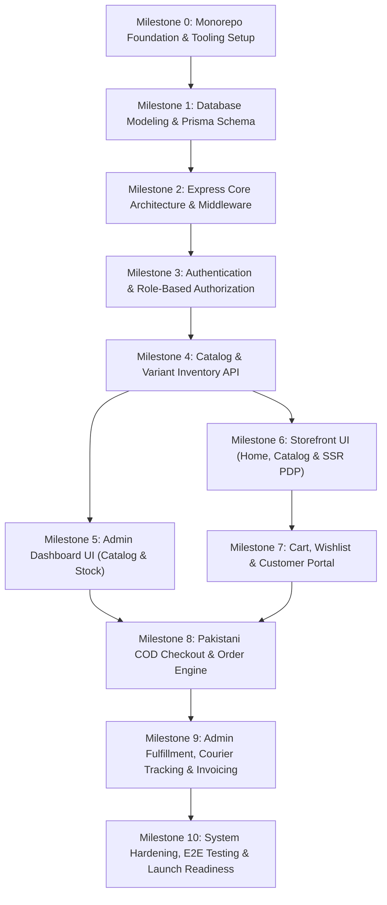

# Implementation Roadmap & Milestone Governance

**Project:** NOIR & GOLD — Luxury Apparel E-Commerce Store  
**Document Version:** 1.0.0  
**Status:** Approved for Phased Execution  
**Date:** October 2026  

---

## 1. Strict Phasing Governance & Approval Gate Rule

> [!IMPORTANT]
> **MANDATORY GOVERNANCE RULE: APPROVAL GATE BEFORE PROGRESSION**  
> Under no circumstances may development work on a subsequent milestone commence until the current milestone has fulfilled all deliverables, passed every verification test, and received formal review and sign-off from the project lead. Skipping milestones or executing work out of sequence is strictly prohibited.

### Execution Protocol
1. **Work Isolation:** Development proceeds strictly within the boundaries of the active milestone.
2. **Review Submission:** Upon completing a milestone's deliverables, an explicit checkpoint report is presented detailing:
   - Deliverables completed.
   - Verification and automated test results.
   - Identified deviations or edge-case decisions.
3. **Formal Approval:** The project lead must inspect and approve the milestone before any files for the next milestone are created or modified.

---

## 2. Milestone Dependencies & Critical Path

---

## 3. Detailed Milestone Breakdown

### Milestone 0: Monorepo Foundation & Tooling Setup
- **Dependencies:** None.
- **Objectives:** Establish the monorepo structure, workspace configuration, TypeScript definitions, Tailwind styling tokens, and environment blueprints.
- **Deliverables:**
  1. Monorepo root with `npm workspaces` configuring `frontend/` and `backend/`.
  2. Next.js App Router application initialized in `frontend/` with TypeScript and Tailwind CSS.
  3. Express application initialized in `backend/` with TypeScript configuration.
  4. Tailwind CSS config containing all NOIR & GOLD design tokens (`#0B0A0F`, `#14111B`, `#D4AF37`, `#E6CA65`, etc.).
  5. Shared TypeScript types package in `shared/` or shared directory.
  6. `.env.example` templates for both applications.
- **Verification & Testing:**
  - `npm run build` succeeds cleanly across both frontend and backend packages.
  - Zero TypeScript compiler errors with `strict: true`.
- **Approval Checkpoint 0:** Clean monorepo structure and shared typing verification.

---

### Milestone 1: Database Modeling, Prisma Schema & Seed Engine
- **Dependencies:** Milestone 0.
- **Objectives:** Formulate the PostgreSQL schema via Prisma ORM, execute migrations, and seed initial Pakistani store data.
- **Deliverables:**
  1. Complete `backend/prisma/schema.prisma` defining models: `User`, `Address`, `Category`, `Product`, `ProductImage`, `ProductVariant`, `InventoryLog`, `ShippingZone`, `Coupon`, `Order`, `OrderItem`, `AuditLog`.
  2. Initial Prisma migration applied cleanly to PostgreSQL.
  3. Database seed script (`seed.ts`) populating:
     - Default super administrator account (`admin@noirandgold.com`).
     - Pakistani shipping zones (Local Karachi: PKR 200, Major Metros: PKR 300, Nationwide: PKR 400).
     - Men's and Women's luxury categories (Pret, Formal, Luxury Casual).
     - Sample luxury products with multi-size and multi-color variants.
- **Verification & Testing:**
  - `npx prisma migrate status` indicates database is up-to-date.
  - `npx prisma db seed` runs idempotently without foreign-key constraint violations.
- **Approval Checkpoint 1:** Prisma schema structure, relations, and seed verification.

---

### Milestone 2: Express Core Architecture & Security Pipeline
- **Dependencies:** Milestone 1.
- **Objectives:** Construct the backend application lifecycle, centralized error handler, logging, and security middleware.
- **Deliverables:**
  1. Express server bootstrap with environment validation via Zod.
  2. Security middleware: `helmet`, `cors` (origin-whitelisted), `express-rate-limit`.
  3. `cookie-parser` and JSON body parsers with payload size limits.
  4. Centralized error handling middleware formatting standardized JSON responses (`{ success: false, error: { code, message, details } }`).
  5. Abstract `StorageService` interface with a local disk driver implementation for development uploads (`/uploads/*`).
  6. Healthcheck endpoint (`GET /api/v1/health`).
- **Verification & Testing:**
  - Healthcheck responds with `200 OK` and database connectivity status.
  - Unhandled exceptions return sanitized `500 Internal Server Error` without exposing stack traces.
- **Approval Checkpoint 2:** Express core pipeline and error response format verification.

---

### Milestone 3: Authentication & Role-Based Authorization Engine
- **Dependencies:** Milestone 2.
- **Objectives:** Implement secure JWT cookie-based session management, password hashing, and role-based guards.
- **Deliverables:**
  1. User registration, login, logout, and token refresh endpoints under `/api/v1/auth`.
  2. Password hashing via Argon2id or bcrypt (cost factor 12).
  3. Dual-token JWT architecture: Short-lived Access Token (15m) + Long-lived Refresh Token (7d) in `HttpOnly`, `SameSite=Strict` cookies.
  4. Authentication middleware (`authenticateUser`) and RBAC middleware (`requireRole(['ADMIN', 'STAFF'])`).
  5. Protected customer profile endpoint (`GET /api/v1/customers/me`) and address management endpoints.
- **Verification & Testing:**
  - Customer registration and login successfully issue HttpOnly cookies.
  - Admin-only routes return `403 Forbidden` when called with customer credentials.
  - Rate limiter blocks authentication attempts after 5 failed tries within 15 minutes.
- **Approval Checkpoint 3:** Auth token security, cookie behavior, and RBAC verification.

---

### Milestone 4: Catalog & Variant Inventory Management API
- **Dependencies:** Milestone 3.
- **Objectives:** Build full RESTful endpoints for categories, products, images, and inventory tracking.
- **Deliverables:**
  1. Public catalog endpoints: `GET /api/v1/products` (filtering by category, size, color, price range, search, sort, pagination) and `GET /api/v1/products/:slug` (full variant matrix and stock counts).
  2. Category tree endpoints: `GET /api/v1/categories`.
  3. Protected Admin product CRUD: Create, update, soft-delete products.
  4. Protected Admin variant matrix manager: Create/update variant SKUs, set individual pricing and sale pricing.
  5. Protected Admin inventory endpoints: Stock adjustments with reason logging to `InventoryLog`.
  6. Product image upload handler using the abstract `StorageService`.
- **Verification & Testing:**
  - Filtering and pagination queries return correct subsets and accurate total page counts.
  - Variant creation enforces unique SKU constraints.
  - Stock adjustment records an immutable entry in the `InventoryLog` table.
- **Approval Checkpoint 4:** Catalog REST endpoints, filtering accuracy, and inventory logging verification.

---

### Milestone 5: Admin Dashboard UI (Catalog & Inventory)
- **Dependencies:** Milestone 4.
- **Objectives:** Develop the dark luxury administrative user interface for managing products, categories, and inventory.
- **Deliverables:**
  1. Admin authentication gate and persistent dashboard layout with collapsible navigation.
  2. Executive overview screen with KPI summary cards (Gross sales, pending orders, low-stock alerts).
  3. Category manager with hierarchy builder and banner image upload.
  4. Product manager table with faceted search, publish status toggles, and stock badges.
  5. Multi-step Product Creator / Editor form: Title, description, categories, image upload with reordering, and dynamic variant matrix generator.
  6. Inventory management screen with inline stock increment/decrement and audit log drawer.
- **Verification & Testing:**
  - Creating a product with 3 sizes and 2 colors correctly generates 6 unique SKUs in the database.
  - Image uploader displays live previews and saves URLs accurately.
- **Approval Checkpoint 5:** Admin catalog and inventory UI functionality and responsiveness.

---

### Milestone 6: Storefront UI (Homepage, Catalog & SSR PDP)
- **Dependencies:** Milestone 4.
- **Objectives:** Construct the luxury customer-facing storefront with Next.js App Router, SSR, and Tailwind CSS.
- **Deliverables:**
  1. Storefront shared layout: Top announcement bar, luxury navigation header, and editorial footer.
  2. Homepage: Editorial campaign banner, curated collection showcases, new arrivals carousel, and brand story block.
  3. Catalog Page (`/shop`): Faceted sidebar filter (Categories, Sizes, Colors, Price Range, In-Stock), sorting selector, responsive product card grid, and pagination.
  4. Category Landing Pages (`/shop/[category]` and subcategory views).
  5. Product Detail Page (`/product/[slug]`):
     - Server-side pre-rendered with OpenGraph tags and JSON-LD schema.
     - Multi-angle high-resolution image gallery with thumbnail carousel and zoom.
     - Interactive color swatch and size chip selectors with live stock indicators.
     - Fabric composition, care instructions, and interactive Size Guide modal (in/cm).
     - Sticky mobile "Add to Cart" action bar.
- **Verification & Testing:**
  - Core Web Vitals audit: LCP < 2.5s, zero layout shift on gallery load.
  - Variant swatches dynamically update gallery imagery and stock badges.
- **Approval Checkpoint 6:** Storefront UI visual fidelity, SSR execution, and mobile responsiveness.

---

### Milestone 7: Cart, Wishlist & Customer Account Portal
- **Dependencies:** Milestone 6.
- **Objectives:** Deliver persistent shopping cart state, wishlist functionality, and customer dashboard.
- **Deliverables:**
  1. Slide-over Cart Drawer (`CartDrawer.tsx`) and dedicated `/cart` page with line item controls.
  2. Client-side cart persistence via `localStorage` with automatic server synchronization upon login.
  3. Stock limit enforcement (preventing quantities exceeding available inventory).
  4. Wishlist state with optimistic UI toggles and persistent database sync for authenticated users.
  5. Customer Account Portal:
     - Dashboard overview with recent orders.
     - Order history list and detailed order invoice view.
     - Pakistani Address Book manager (Add, Edit, Set Default).
     - Profile settings and password update form.
- **Verification & Testing:**
  - Guest cart seamlessly merges into customer account upon login.
  - Attempting to add more items than available stock displays a polite warning banner.
- **Approval Checkpoint 7:** Cart state synchronization, stock limit enforcement, and customer portal usability.

---

### Milestone 8: Pakistani COD Checkout & Order Processing Engine
- **Dependencies:** Milestone 5, Milestone 7.
- **Objectives:** Implement the Cash on Delivery checkout flow, delivery zone fee engine, and transactional order creation.
- **Deliverables:**
  1. Pakistani checkout form (`/checkout`): Recipient Name, Pakistani Mobile Number (`03XX-XXXXXXX`), Landmark, City dropdown, Province.
  2. Shipping zone calculation API (`/api/v1/shipping/calculate`) applying zone fees (Karachi: PKR 200, Metros: PKR 300, Nationwide: PKR 400, Free shipping threshold).
  3. Coupon code validation and discount application.
  4. Transactional order creation endpoint (`POST /api/v1/orders`):
     - Executes within `prisma.$transaction`.
     - Validates stock and recalculates all prices on the server.
     - Decrements variant inventory.
     - Generates human-readable order number (`NG-YYYY-XXXXX`).
  5. Order Confirmation page (`/checkout/success/[orderNumber]`) with printable receipt and delivery expectation notice.
  6. Public Order Tracking page (`/track-order`) querying by Order Number and Phone Number.
- **Verification & Testing:**
  - Concurrent checkout simulation confirms no overselling occurs when stock is depleted.
  - Client-tampered prices submitted in request payloads are completely ignored; order calculates strictly from DB records.
  - Invalid Pakistani phone numbers fail validation with inline feedback.
- **Approval Checkpoint 8:** Checkout transaction safety, pricing recalculation integrity, and order creation.

---

### Milestone 9: Admin Fulfillment, Courier Tracking & Operations
- **Dependencies:** Milestone 8.
- **Objectives:** Build the complete order fulfillment interface, courier tracking assignment, and operational tools for store staff.
- **Deliverables:**
  1. Admin Orders table with tabbed status filtering (`Pending`, `Confirmed`, `Processing`, `Shipped`, `Delivered`, `Cancelled`, `Failed Delivery`, `Returned`).
  2. Order Detail View:
     - Itemized list with thumbnail snapshots.
     - Delivery address, landmark, and contact phone number.
     - Status transition workflow buttons with confirmation dialogs.
     - Manual courier partner assignment (TCS, Trax, Leopards) and Tracking ID input.
     - Internal staff notes.
     - Printable Packing Slip & Tax Invoice formatted for standard A4 / thermal printers.
  3. Customer Directory table with order totals and lifetime spend in PKR.
  4. Coupon manager UI: Create and toggle discount codes with expiration and minimum spend limits.
  5. Shipping zones manager UI: Update flat fees and free delivery thresholds.
- **Verification & Testing:**
  - Changing an order from `SHIPPED` to `FAILED_DELIVERY` and then `RETURNED` triggers an inventory log and replenishes variant stock.
  - Packing slip prints cleanly with no UI artifacts.
- **Approval Checkpoint 9:** Admin fulfillment lifecycle, courier assignment, and inventory replenishment logic.

---

### Milestone 10: System Hardening, E2E Testing & Launch Readiness
- **Dependencies:** Milestone 9.
- **Objectives:** Execute end-to-end automated testing, accessibility audits, security penetration verification, and production build readiness.
- **Deliverables:**
  1. Automated E2E test suite covering:
     - Guest browse -> Variant select -> Add to cart -> COD checkout -> Order confirmation.
     - Customer registration -> Login -> Profile update -> Order history review.
     - Admin login -> Product creation -> Stock adjustment -> Order status transition.
  2. WCAG 2.1 AA accessibility audit: Contrast checks across dark purple, obsidian, and gold tokens.
  3. Security hardening audit: OWASP Top 10 checklist verification, rate limiting stress test, SQL injection defense check.
  4. Production environment configuration guide and deployment runbook.
- **Verification & Testing:**
  - 100% passing E2E test suite.
  - Production builds (`npm run build`) pass with zero errors, zero lint warnings, and clean bundle sizes.
- **Approval Checkpoint 10:** Final production launch readiness sign-off.

---

## 4. Milestone Summary Matrix

| Milestone | Key Focus Area | Deliverables | Gate Rule |
| :--- | :--- | :--- | :--- |
| **Milestone 0** | Tooling & Monorepo Setup | Workspaces, Next.js, Express, Tailwind tokens | Requires Sign-Off |
| **Milestone 1** | Database Modeling & Seed | Prisma schema, PostgreSQL migrations, Seed data | Requires Sign-Off |
| **Milestone 2** | Express Core Architecture | Middleware, Error handler, Storage adapter | Requires Sign-Off |
| **Milestone 3** | Authentication & RBAC | JWT cookies, password hashing, user roles | Requires Sign-Off |
| **Milestone 4** | Catalog & Inventory API | Product/Category/Variant REST endpoints | Requires Sign-Off |
| **Milestone 5** | Admin Dashboard UI | Catalog UI, Variant matrix generator, Stock UI | Requires Sign-Off |
| **Milestone 6** | Storefront Browsing UI | Home, Catalog, Filters, SSR Product Details | Requires Sign-Off |
| **Milestone 7** | Cart & Customer Portal | Cart drawer, localStorage sync, Customer account | Requires Sign-Off |
| **Milestone 8** | COD Checkout Engine | Pakistani address validation, Zone fees, Transactions | Requires Sign-Off |
| **Milestone 9** | Admin Order Fulfillment | Order lifecycle, Courier tracking, Invoicing | Requires Sign-Off |
| **Milestone 10** | Hardening & Launch | E2E test suite, WCAG audit, Security checklist | Final Launch Sign-Off |
