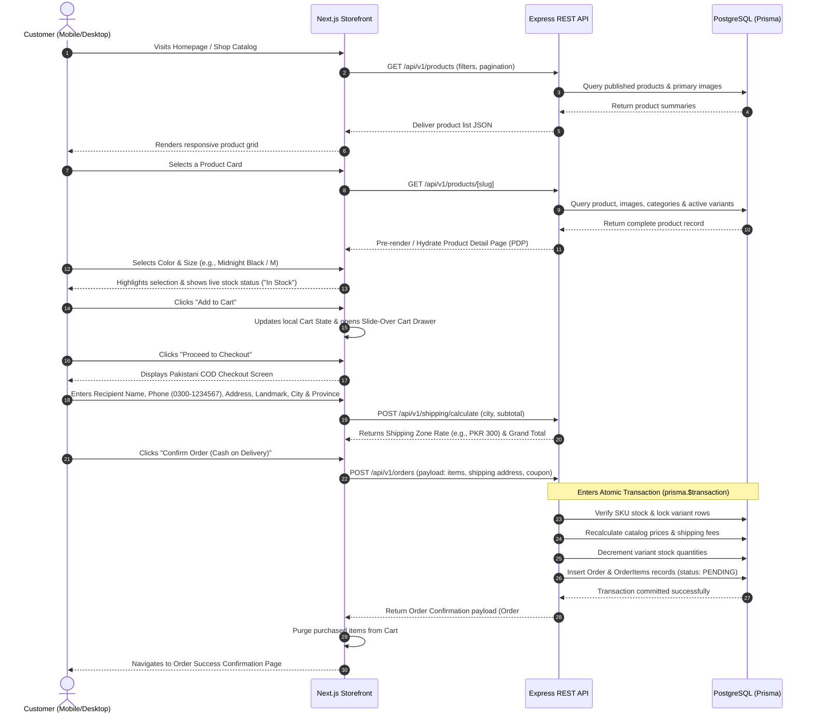
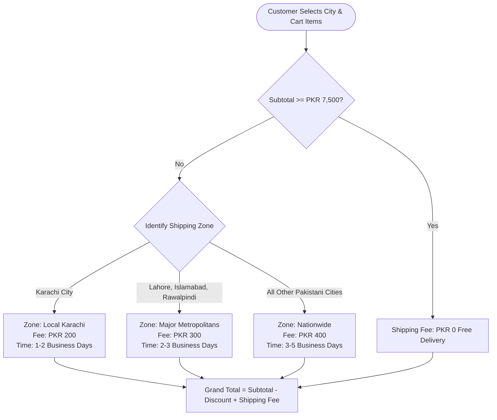
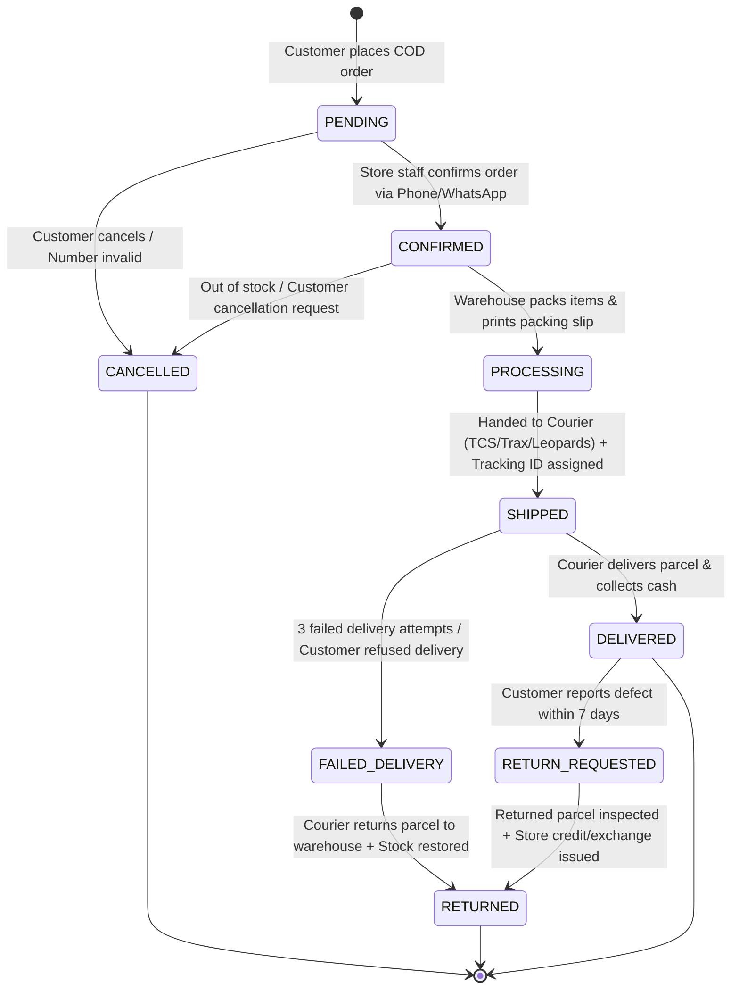

# User Journeys, Operational Workflows & Edge Cases

**Project:** NOIR & GOLD — Luxury Apparel E-Commerce Store  
**Document Version:** 1.0.0  
**Status:** Approved for Implementation Planning  
**Date:** October 2026  

---

## 1. End-to-End Browse-to-Purchase Journey (Customer Flow)

The customer flow is optimized for intuitive discovery, swift variant selection, and a frictionless Cash on Delivery (COD) checkout experience tailored to Pakistani shoppers.



---

## 2. Product Variant Selection & Cart Management

### 2.1 Variant Matrix Interaction Logic
1. **Initial Page Load:**
   - The product page defaults to the first available color and the first in-stock size.
   - If all variants are out of stock, the primary CTA reflects `"Sold Out"` and becomes disabled.
2. **Color Change:**
   - Selecting a new color updates the gallery view to show images corresponding to that color.
   - The size selector updates dynamically to reflect stock availability for that specific color.
3. **Size Change:**
   - Selecting an in-stock size displays `"In Stock"` or `"Only [N] items left"` if stock is below 3 units.
   - Selecting an out-of-stock size disables the `"Add to Cart"` button and displays `"Size Currently Out of Stock"`.

### 2.2 Cart Synchronization (Guest vs. Authenticated Customer)
- **Guest Visitor:**
  - Cart line items `{ variantId, quantity }` are saved in browser `localStorage`.
  - When the cart drawer opens, the UI fetches current pricing and stock verification from `/api/v1/cart/validate`.
- **Customer Sign-In / Registration:**
  - Upon logging in, any items residing in the guest `localStorage` cart are merged into the customer's account cart on the backend database.
  - If identical variants exist in both, quantities are combined (capped at maximum available inventory).

---

## 3. Cash on Delivery (COD) Checkout & Order Creation

### 3.1 Pakistani Delivery Details Capture
The checkout form captures details specifically structured for Pakistani logistics:
1. **Full Name:** Recipient's complete name.
2. **Mobile Phone Number:** Strictly validated for Pakistani mobile network operators (`0300`-`0349`, total 11 digits without country code, or normalized from `+923XXXXXXXXX`).
3. **Alternative Phone Number (Optional):** Highly recommended for couriers in case the primary number is unreachable upon delivery.
4. **Complete Street Address:** House/Apartment number, building name, street/sector.
5. **Nearest Landmark:** Required field (e.g., "Opposite Chase Up, near National Hospital") to overcome informal address numbering.
6. **City Selection:** Dropdown list of 150+ Pakistani cities with search autocomplete (e.g., Karachi, Lahore, Islamabad, Rawalpindi, Faisalabad, Multan).
7. **Province Selection:** Auto-selected based on city or manually chosen from Sindh, Punjab, Khyber Pakhtunkhwa, Balochistan, ICT, AJK, Gilgit-Baltistan.
8. **Delivery Instructions / Order Notes:** Optional instructions (e.g., "Please call before arrival").

### 3.2 Dynamic Delivery Zone Fee Computation



---

## 4. Admin Order Processing & Dispatch Lifecycle



### 4.1 Step-by-Step Staff Fulfillment Protocol
1. **Verification Call / Message (State: `PENDING` -> `CONFIRMED`):**
   - High COD Return-to-Origin (RTO) rates in Pakistan make verification essential for luxury goods.
   - Staff member calls or messages the customer on WhatsApp to confirm delivery address, recipient availability, and readiness to pay cash upon arrival.
   - Once verified, order status is updated to `CONFIRMED`.
2. **Packing & Invoicing (State: `CONFIRMED` -> `PROCESSING`):**
   - Staff prints the standardized **NOIR & GOLD Packing Slip / Invoice**.
   - Warehouse picks the specific SKUs, conducts quality control inspection, and packs the garment into branded luxury packaging with garment bag and seal.
3. **Courier Booking & Dispatch (State: `PROCESSING` -> `SHIPPED`):**
   - Staff registers the parcel in the courier portal (TCS, Trax, Leopards, or Call Courier).
   - Staff enters the **Courier Name** and **Tracking Consignment Number** into the order record in the admin panel and sets status to `SHIPPED`.
   - The customer can now track their order using this tracking number.
4. **Delivery & Cash Collection (State: `SHIPPED` -> `DELIVERED`):**
   - Courier rider hands over parcel, collects physical PKR cash, and reconciles delivery in the courier portal.
   - Staff updates order to `DELIVERED`.

---

## 5. Cancellation, Failed-Delivery & Return Realities (RTO Handling)

### 5.1 Failed Delivery / Return to Origin (RTO) Handling
- **Trigger:** Courier rider attempts delivery 3 times; customer phone is switched off, customer refuses payment, or address cannot be located.
- **Workflow:**
  1. Courier flags delivery failure and initiates return to merchant warehouse.
  2. Staff sets order status to `FAILED_DELIVERY`.
  3. When the physical parcel arrives back at the warehouse and is verified intact, staff marks status as `RETURNED`.
  4. The system logs an inventory replenishment entry, returning the reserved items back into available stock.

### 5.2 Exchange & Return Policy Flow
- **Eligibility:** 7-day inspection window from date of delivery. Must be unused, with original designer tags and packaging intact.
- **Protocol:**
  1. Customer submits inquiry via Contact Us or WhatsApp with order number and photos of the garment.
  2. Staff reviews and creates a return record in status `RETURN_REQUESTED`.
  3. Customer ships parcel back to the Karachi/Lahore atelier.
  4. Inspection team verifies condition; upon approval, staff fulfills replacement size or issues store credit.

---

## 6. Error Scenarios, Race Conditions & Empty States

### 6.1 Concurrent Checkout & Race Conditions (Inventory Exhaustion)
- **Scenario:** Two customers have the final unit of "Velvet Nocturne Sherwani - Size L" in their carts simultaneously and click "Confirm Order" at the same second.
- **System Safeguard:**
  - Express backend wraps order creation in a PostgreSQL serializable transaction using `prisma.$transaction`.
  - The first transaction locks the variant record and decrements stock to 0.
  - The second transaction detects `stock_quantity < requested_quantity` and immediately rolls back with an HTTP `409 Conflict`:
    ```json
    {
      "success": false,
      "error": {
        "code": "OUT_OF_STOCK",
        "message": "We apologize, but 'Velvet Nocturne Sherwani (Size L)' was just purchased by another customer and is now out of stock."
      }
    }
    ```
  - The frontend catches this error, highlights the affected item in the cart drawer, and prevents fraudulent order creation.

### 6.2 Idempotency & Accidental Double-Submission
- **Scenario:** Customer on a slow mobile connection repeatedly taps the "Confirm Order" button.
- **System Safeguard:**
  - Frontend disables the submit button immediately upon first tap and renders a loading spinner.
  - A unique client-side transaction key (UUID) is attached to the request header; duplicate submissions with the same key within a 60-second window are rejected with HTTP `429` or return the already created order.

### 6.3 Empty States Design
- **Empty Cart:** Renders a minimalist luxury illustration, message: *"Your shopping bag is currently empty"*, with a prominent Gold CTA: *"Discover New Arrivals"*.
- **No Search Results:** Message: *"No garments matched your search for '[query]'."*, followed by suggestions: *"Check spelling or browse our curated collections"*, displaying links to Men's and Women's collections.
- **Empty Order History:** Message: *"You have not placed any orders yet"*, with direct link to the Master Catalog.
